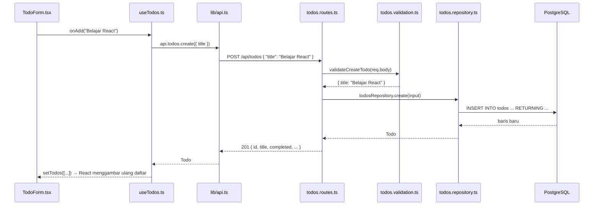

# 2. Cara kerja

## Gambaran besar

```
┌─────────────── Browser ───────────────┐      ┌────────────── Backend ──────────────┐      ┌──── PostgreSQL ────┐
│ components/  →  hooks/  →  lib/api.ts │ HTTP │ routes → validation → repository    │ SQL  │ tabel todos, …     │
│   (tampilan)    (state)    (fetch)    │ ───► │ (URL)    (cek input)  (query)       │ ───► │                    │
│                                       │ JSON │                                     │      │                    │
│ ◄──────────────────────────────────── │ ◄─── │ ◄────────────────────────────────── │ ◄─── │                    │
└───────────────────────────────────────┘      └─────────────────────────────────────┘      └────────────────────┘
      frontend/ (port 5173)                          backend/ (port 4000)
```

Frontend dan backend hanya berkomunikasi lewat **HTTP + JSON**. Keduanya tidak saling meng-import kode. Yang menyamakan keduanya adalah **types** (`src/types/`) yang ditulis dengan bentuk sama di kedua sisi.

## Alur satu request

Contoh: pengguna mengetik "Belajar React" lalu menekan **Add**.



Langkah demi langkah:

| # | File | Yang terjadi |
| --- | --- | --- |
| 1 | `frontend/src/components/TodoForm.tsx` | Form di-submit. `useTodoForm` memanggil `onAdd(title)`. |
| 2 | `frontend/src/hooks/useTodos.ts` | `add()` memanggil `api.todos.create(...)`. Jika berhasil, todo baru dimasukkan ke state `todos`. |
| 3 | `frontend/src/lib/api.ts` | `request()` menjalankan `fetch('/api/todos', { method: 'POST', body })`. |
| 4 | `frontend/vite.config.ts` | Saat development, Vite meneruskan (proxy) `/api/*` ke `http://localhost:4000`. |
| 5 | `backend/src/app.ts` | Middleware berjalan: `helmet` (header keamanan), `cors`, `express.json` (membaca body JSON), `morgan` (log). Lalu request diarahkan ke `todosRouter`. |
| 6 | `backend/src/modules/todos/todos.routes.ts` | Handler `POST /` dipanggil. |
| 7 | `backend/src/modules/todos/todos.validation.ts` | `validateCreateTodo` memeriksa `req.body`. Jika salah, melempar `HttpError(400)`. |
| 8 | `backend/src/modules/todos/todos.repository.ts` | `create` menjalankan `INSERT` lewat `pool.query`. |
| 9 | `backend/src/db/pool.ts` | Koneksi ke PostgreSQL berdasarkan `DATABASE_URL`. |
| 10 | `todos.routes.ts` | `res.status(201).json(todo)` mengirim hasil ke frontend. |
| 11 | `useTodos.ts` | State berubah, React otomatis menggambar ulang `TodoList`. |

### Jika input salah

Misalnya title kosong:

1. `validateCreateTodo` melempar `new HttpError(400, 'Title is required', [...])`.
2. Express 5 menangkap error itu secara otomatis (tidak perlu `try/catch` di route) dan meneruskannya ke `backend/src/middleware/error-handler.ts`.
3. Error handler mengirim `400 { "error": { "message": "Title is required", "details": [...] } }`.
4. Di frontend, `request()` melihat status bukan 2xx, lalu melempar `ApiError`.
5. `useTodos` menangkapnya dan mengisi state `error`.
6. `TodosPanel` menampilkan pesan itu di alert merah Bootstrap.

## Peran setiap folder

### Backend (`backend/`)

| Lokasi | Peran | Kapan diubah |
| --- | --- | --- |
| `database/schema.sql` | Struktur semua tabel | Menambah/mengubah tabel atau kolom |
| `database/seed.sql` | Data contoh | Ingin data awal yang berbeda |
| `src/types/` | Bentuk data (`interface`/`type`) | Setiap kali bentuk data berubah |
| `src/modules/<fitur>/` | Satu fitur: `*.routes.ts`, `*.validation.ts`, `*.repository.ts` | Menambah/mengubah fitur |
| `src/lib/validation.ts` | Helper validasi: `requireObject`, `assertNoErrors`, `parseId` | Jarang |
| `src/lib/http-error.ts` | Class `HttpError` untuk mengirim error dengan status tertentu | Jarang |
| `src/middleware/error-handler.ts` | Mengubah semua error menjadi response JSON | Jarang |
| `src/config/env.ts` | Membaca & memvalidasi `.env` | Menambah environment variable |
| `src/db/pool.ts` | Koneksi PostgreSQL | Jarang |
| `src/app.ts` | Middleware & daftar router | Menambah modul baru |
| `src/index.ts` | Menyalakan server | Hampir tidak pernah |

### Frontend (`frontend/`)

| Lokasi | Peran | Kapan diubah |
| --- | --- | --- |
| `src/types/` | Bentuk data, sama dengan backend | Setiap kali bentuk data berubah |
| `src/lib/api.ts` | Semua pemanggilan API (`fetch`) | Menambah endpoint |
| `src/hooks/` | State + aksi per fitur (`useTodos`, …) | Menambah/mengubah perilaku |
| `src/components/` | Tampilan (JSX + class Bootstrap) | Mengubah tampilan |
| `src/components/XxxPanel.tsx` | Menggabungkan hook + komponen satu fitur | Menambah fitur |
| `src/constants.ts` | Label & pilihan tetap untuk tampilan | Menambah pilihan/label |
| `src/App.tsx` | Layout halaman (header, panel) | Menambah fitur/tab |
| `src/main.tsx` | Import CSS Bootstrap, dark mode, render `App` | Hampir tidak pernah |
| `src/index.css` | CSS tambahan di atas Bootstrap | Jika tidak ada class Bootstrap yang cocok |
| `vite.config.ts` | Port dev server & proxy `/api` | Mengubah port |

## Konvensi penamaan

| Hal | Aturan | Contoh |
| --- | --- | --- |
| Tabel & kolom database | `snake_case`, tabel jamak | `todos`, `created_at` |
| Field di JSON / TypeScript | `camelCase` | `createdAt` |
| Mengubah `snake_case` → `camelCase` | Alias di query: `created_at AS "createdAt"` | lihat `COLUMNS` di repository |
| Folder modul backend | jamak, huruf kecil | `modules/todos/`, `modules/notes/` |
| File modul backend | `<fitur>.<peran>.ts` | `todos.routes.ts` |
| Import di backend | **wajib** berakhiran `.js` (aturan ES Modules di Node.js), walaupun file aslinya `.ts` | `'./todos.repository.js'` |
| Komponen React | `PascalCase.tsx` | `TodoList.tsx` |
| Hook React | diawali `use` | `useTodos.ts` |
